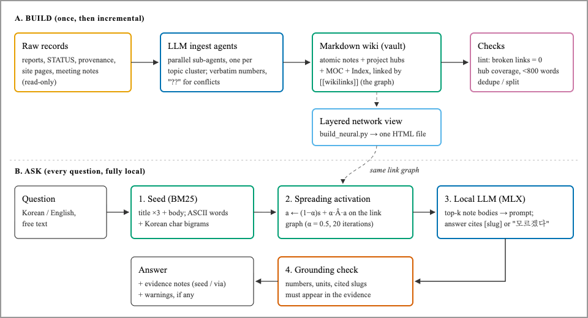
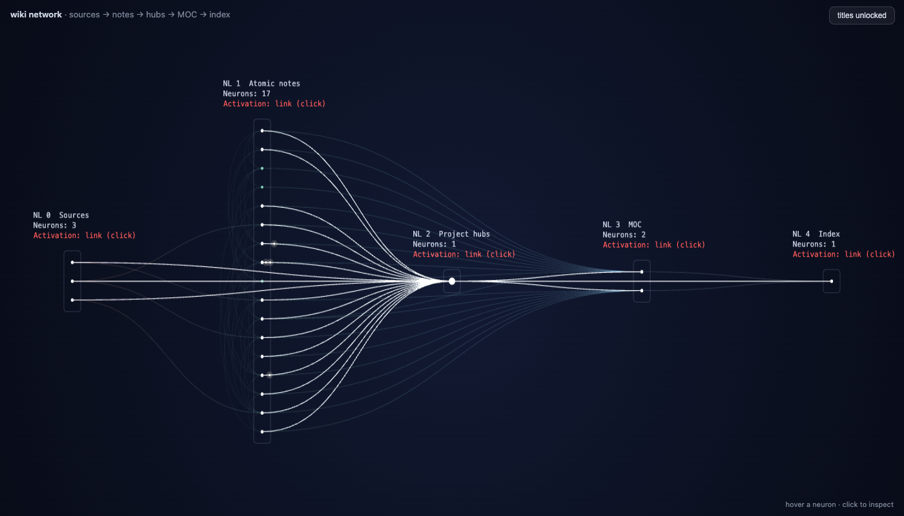

# wiki-spreading-rag

**연구 위키(markdown + `[[wikilink]]`)를 그래프 확산 검색과 로컬 LLM으로 질의하는 최소 구성.** 학습(fine-tuning)·강화학습 없이, 노트끼리의 링크를 검색 신호로 쓰고 답은 노트 인용으로만 하게 만든다. 모든 단계가 노트북 한 대에서 돈다.

*English summary — A minimal, fully local setup to ask questions of a personal research wiki. BM25 seeds a spreading-activation search over the wiki's link graph and returns the relevant lines of each note in ~0.05 s; a small local LLM (MLX, or any OpenAI-compatible server such as Ollama) can add a summary that cites notes, and a mechanical check flags numbers, units and citations that do not appear in the evidence. Search comes first: in our tests an 8B model picked the wrong value from version tables in 2 of 3 runs, so numbers should be read from the evidence lines. No fine-tuning or RL.*

<p align="center"></p>

**Fig. 1.** 구축(A)과 질의(B) 흐름. 위키 링크 그래프 하나가 검색(B-2)과 시각화(A, layered network view)에 함께 쓰인다.

<p align="center"></p>

**Fig. 2.** 예시 vault의 층 신경망 시각화(`build_neural.py`). 왼쪽부터 원본(Sources) → atomic notes → 프로젝트 허브 → MOC → Index이고 강조된 흰 곡선은 한 노트의 링크 전체다. 학습된 가중치가 아니라 `[[wikilink]]`를 그린 은유다.

---

## 무엇이 들어 있나

| 파일 | 역할 |
|---|---|
| `src/wikigraph.py` | vault → 노드·링크 그래프 (Obsidian 방식 링크 해석: 상대경로 → 파일명 → `aliases`) |
| `src/spread_search.py` | BM25 seed + 그래프 확산(personalized-PageRank식) 검색 |
| `src/wiki_app.py` | **브라우저 앱(권장).** 검색 결과(노트별 해당 줄)를 즉시 보여 주고 로컬 모델 요약을 스트리밍. 근거 노트는 클릭하면 Obsidian에서 열림 |
| `src/wiki_ask.py` | 같은 흐름의 CLI판. 숫자·단위·인용을 근거와 기계 대조하는 `check()` 포함 |
| `src/build_neural.py` + `templates/` | vault를 층 신경망 모양 HTML 한 장으로 렌더. 뉴런을 누르면 노트 본문(markdown) 표시, 제목·본문 AES 암호화 옵션 |
| `example_vault/` | 가상의 DFT·전자수송 학습 위키 (바로 돌려 볼 수 있는 예시) |
| `docs/guide.md` | 자기 위키에 적용하는 단계별 가이드 (vault 규약, LLM ingest, 평가) |
| `src/canon.py`, `src/stale_check.py` | 정본 값 등록부(`canon-*.md`) 읽기, 이전 값이 상태 표시 없이 쓰인 줄 찾기. 검색은 대체된 노트를 낮추고 검사기는 답의 이전 값을 경고 |
| `src/staging_merge.py`, `src/compare_runs.py` | 격리형 crew의 supervisor 병합(충돌 검출), 단독 대 crew 대조 지표 |
| `src/lint.py`, `src/eval.py`, `eval/questions.md` | 링크 점검, 평가 질문과 Recall@k 측정 (평가 파일은 vault 밖에 둔다) |
| `docs/example-output.txt`, `docs/wiki-neural-example.html` | 예시 vault로 실제 실행한 답변 출력과 시각화 결과 |
| `docs/ingest-brief-template.md` | 원본 문서를 위키 노트로 정리시키는 LLM 에이전트 브리프 템플릿 |

## 빠른 시작

```bash
git clone https://github.com/nangman98/wiki-spreading-rag && cd wiki-spreading-rag

# 1) 브라우저 앱 (Apple Silicon, 권장)
pip install mlx-lm
python3 src/wiki_app.py --vault example_vault        # 첫 실행 때 모델(약 4–5 GB) 다운로드
# 앱이 이 터미널을 점유한다. 브라우저에서 http://localhost:8765 를 연다 ("로컬 모델 요약" 체크를 끄면 검색만, 0.1 s 이내)

# 1') Ollama · LM Studio · llama.cpp 서버를 쓰는 경우 (Windows/Linux 포함)
python3 src/wiki_app.py --vault example_vault --backend openai \
        --base-url http://localhost:11434/v1 --model qwen3:8b

# 2) 검색만 CLI (의존성 없음, Python 3.9+)
python3 src/spread_search.py "band gap 과소평가가 transmission에 주는 영향"

# 3) 신경망 모양 시각화
python3 src/build_neural.py --out wiki-neural.html && open wiki-neural.html
```

자기 위키에 쓰려면 `--vault ~/my-vault` 또는 환경변수 `WIKI_VAULT`를 준다. 앱은 `127.0.0.1`에만 열리고 기본 경로(`--backend mlx`)에서는 노트 내용이 기기 밖으로 나가지 않는다. `--backend openai`로 다른 기기의 서버를 지정하면 근거 줄이 그 서버로 전송된다.

## 작동 방식

1. **Seed.** 질문과 각 노트(제목 3배 가중 + 본문)의 BM25 점수 상위 8개가 출발점이다. 한국어는 형태소 분석 없이 글자 bigram으로 쪼갠다(조사가 붙어도 매칭).
2. **Spread.** 대칭 정규화 인접행렬  위에서 `a ← (1−α)s + α·Â·a`를 20회 반복한다(α = 0.5). 질문 단어가 없어도 링크로 이어진 노트가 따라 올라오고 링크만 많은 허브는 √degree 정규화로 눌린다. 결과마다 "seed" 또는 "via 어느 노트"가 붙는다.
3. **Evidence.** 상위 6개 노트에서 제목·주장 줄과, 질문 단어가 가장 많이 겹치는 줄(표는 제목 줄과 함께 통째로)을 노트당 700자까지 뽑는다. 앱은 이 줄들을 먼저 보여 준다. 수치 확인은 여기서 한다.
4. **Answer (선택).** 그 줄들만 프롬프트에 넣고 규칙(노트에 없으면 "모르겠다", 수치 그대로, `[slug]` 인용)을 시스템 프롬프트로 고정해 로컬 모델이 요약을 스트리밍한다.
5. **Check.** 답의 숫자, "숫자+단위" 쌍, 인용 slug가 근거 노트에 실제로 있는지 정규식으로 대조해 경고를 붙인다. 작은 모델의 대표 오류(단위 창작, 없는 노트 인용)를 여기서 잡는다.

이 구조는 HippoRAG(Gutiérrez et al. 2024, arXiv:2405.14831)의 Personalized PageRank 검색과 같은 계열이다. 차이는 LLM으로 지식 그래프를 추출하지 않고 사람이 이미 만든 `[[wikilink]]`를 그대로 쓴다는 점이다(인덱싱 비용 0).

## 로컬 모델: 무엇으로 돌렸고 어떻게 작동하나

저자 환경은 Apple M4, RAM 16 GB, 모델은 `mlx-community/Qwen3-8B-4bit`(MLX, thinking off)이다. 위키는 검색 대상 문서 542개(`notes/` 492개 + 루트·`code/` 문서, `raw/`·`archive/` 제외), 링크 약 2,800개(무방향)다. 앱을 켜면 모델을 한 번 메모리에 올리고(5.2–5.5 s, 최대 사용 6.2 GB), 질문마다 위 1–5단계를 돈다.

**시간은 대부분 모델이 프롬프트를 읽는 데(prefill) 쓰인다.** 측정한 속도는 prefill 151–167 tok/s, 생성 17–21 tok/s다.

| 실행 (같은 질문: 2·3분자 정본 T(E_F)) | 프롬프트 | 걸린 시간 | 답 |
|---|---|---|---|
| CLI, 노트 전문 1,800자 × 6 | 7,680 tok | 약 72 s | 값 정확, 무차원 값에 "eV"를 붙임 (검사가 검출) |
| 앱, 관련 줄 700자 × 6 | 3,077 tok | 24.2 s | **틀림**: 같은 표의 폐기된 판 값을 고름 (검사 통과) |
| 앱, 관련 줄 1,400자 × 6 | 5,756 tok | 42.2 s | **틀림**: 폐기된 판 값 + "eV" (단위만 검사가 검출) |
| 검색만 (모델 없음) | — | 0.03–0.05 s | 판별 값 표가 정본 표시와 함께 그대로 나옴 |

판정 [잠정, 질문 1개·3회]: 노트에 같은 양의 여러 판 값이 표로 함께 있으면 8B 모델은 정본을 안정적으로 고르지 못한다. 검사기는 "근거에 없는 숫자·단위·인용"은 잡지만 "근거에 있는데 질문에 안 맞는 숫자"는 잡지 못한다. 그래서 앱은 **검색 결과(근거 줄)를 주 출력**으로, 모델 요약을 참고용으로 둔다. 틀린 두 번 모두 근거로 들어간 표에는 판마다 상태 열(정본/폐기)이 있었다. 즉 노트에 상태를 적어 두는 것만으로는 8B 모델의 오답을 막지 못했다. 노트 형식을 바꿔서 막을 수 있는지는 측정하지 않았다.

예시 vault(파일 25개, 그중 검색 대상 22개, 정본 값 등록부 예시 1개 포함)에서 평가 질문 4개(`eval/questions.md`, `python3 src/eval.py`)로 잰 검색 recall:

| | BM25만 (α=0) | 확산 (α=0.5) |
|---|---|---|
| Recall@3 평균 | 0.73 | 0.67 |
| Recall@5 평균 | 0.79 | 0.79 |

이 작은 vault에서는 확산의 이득이 없다. 등록부 노트 1개를 추가하자 Recall@5가 두 방식 모두 0.85에서 0.79로 내려갔다. 노트 하나가 늘어도 상위 5위 안의 자리를 다툰다. 노트가 적고 링크가 촘촘해 BM25 상위권이 이미 정답 근처를 덮기 때문으로 보이며 [잠정], 질문 4개는 판정에 부족하다. 확산이 효과를 내는지는 자기 위키의 평가셋으로 재야 한다(guide §6). 수치를 맞추려고 α를 조정하지 않았다.

## 단독 대 crew 대조 실험

같은 입력(실제 연구 프로젝트 하나의 원고·사이트 문서 27개)을 단독 에이전트 1개와 격리형 crew 2개(디렉토리 기준 17 / 10개)에 주고 같은 vault 스냅샷에서 시작해 각자 staging에만 쓰게 했다. 브리프는 `docs/ingest-brief-template.md`, 비교는 `src/compare_runs.py`, 충돌 검출은 `src/staging_merge.py`.

| | 단독 1개 | crew 2개 |
|---|---|---|
| 원본 수치 커버리지 (원본의 3자리 이상 숫자 531개 중 노트에 그대로 실린 비율) | 0.50 | 0.52 |
| 출처 없는 숫자 (원본·vault 어디에도 없음) | 1 | 8 — 노트에 명시한 단위 환산·부호 규약 변환. 지어낸 값은 0 |
| 산출 | 노트 11개, 충돌 0 | 초안 18개, 병합 충돌 4건 (같은 기존 노트 이중 수정 3, 같은 주제 새 노트 1) |
| 깨진 링크 | 0 | 0 |
| 토큰 | 214,234 | 315,323 (1.47배) |
| 걸린 시간 | 369 s | 322 s (병렬, 병합 시간 제외) |

판정 [잠정, 그룹 1개·1회]: 이 규모에서는 crew가 비용을 회수하지 못한다. 커버리지 +0.02에 토큰 1.47배, 손으로 합칠 충돌 4건이 생긴다. 충돌은 모두 병합 스크립트가 잡았다(제목이 긴 주장 문장이라 제목 유사도는 0.10이었고 slug 유사도 0.80으로 검출). 그래서 저자는 문서 수십 개 규모는 단독, 서로 겹치지 않는 디렉토리 묶음이 여럿일 때만 crew로 나눈다. 모델이 바뀌면 같은 비교를 다시 한다.

이 설계는 Kim et al.(arXiv:2512.08296)의 결과를 따른다. 병렬 과제에서 중앙 조정형이 +80.9 %였지만 검증 단계 없는 독립형은 오류를 17.2배 키웠고(중앙형 4.4배), 단일 에이전트가 이미 잘하는 과제에서는 이득이 사라졌다.

## 모델·런타임 선택지

코드가 지원하는 경로는 두 가지다. `--backend mlx`(기본)는 모델을 프로세스 안에 올리고 `--backend openai`는 OpenAI 호환 `/v1/chat/completions` 서버 아무것에나 붙는다.

| 런타임 | 플랫폼 | 연결 | 이 저장소에서 검증 |
|---|---|---|---|
| MLX (`mlx-lm`) | Apple Silicon | `--backend mlx` | 검증 (위 표) |
| `mlx_lm.server` | Apple Silicon | `--backend openai --base-url http://localhost:8090/v1` (실행 시 지정한 포트) | 검증 (같은 모델, 답·검사 정상) |
| Ollama | macOS · Linux · Windows | `--base-url http://localhost:11434/v1 --model qwen3:8b` | 미검증 (같은 API 경로) |
| LM Studio | macOS · Linux · Windows | `--base-url http://localhost:1234/v1` | 미검증 |
| llama.cpp `llama-server` | CPU · NVIDIA · AMD · Apple | `--base-url http://localhost:8080/v1` | 미검증 |

모델은 4-bit 기준으로 대략 "파라미터(B) × 0.6 GB + 문맥"의 메모리를 쓴다(실측: 8B → 최대 6.2 GB). 이 저장소에서 돌려 본 모델은 Qwen3-8B 하나다.

| 메모리 | 후보 (모두 오픈 가중치, 미검증은 표시) | 비고 |
|---|---|---|
| 8 GB | Qwen3-4B, Gemma 3 4B (미검증) | 속도는 8B의 약 2배 예상, 수치 고르기는 더 약할 것 [잠정] |
| 16 GB | **Qwen3-8B (검증)**, EXAONE 3.5 7.8B (한국어 특화, 미검증) | 이 저장소의 기준 |
| 32 GB 이상 | Qwen3-14B, Gemma 3 12B (미검증) | 판별 표에서 정본을 고르는 정확도가 오를 것으로 기대 (평가셋으로 확인 필요) |

모델별 라이선스(상업적 사용 가능 여부 등)는 각 모델 카드를 직접 확인한다.

## 이 방식이 합리적인가

| 부분 | 판단 |
|---|---|
| 이미 있는 `[[wikilink]]`를 검색 신호로 쓰기 | 합리적. 그래프 추출 비용 0 (HippoRAG 계열) |
| 근거 줄을 먼저 보여 주기 | 합리적. 0.05 s, 틀릴 수 없는 출력 |
| 검사기 | 유용. 지어낸 단위·없는 인용을 실제로 잡음. 한계는 아래 |
| 16 GB 노트북의 8B 요약 | 보조로만. 24–72 s, 판별 수치를 잘못 고름 |
| 직접 만든 앱 | Ollama + Open WebUI, Obsidian Smart Connections 같은 기성 도구로 채팅 자체는 대체된다. 이 저장소의 몫은 vault 규약, 링크 그래프 검색, 근거 줄 추출, 검사기다 |

## 왜 학습시키지 않나

개인 지식을 모델 가중치에 넣는 fine-tuning은 사실 지식 주입에서 RAG보다 성능이 낮고(Ovadia et al. 2023, arXiv:2312.05934) 새 지식을 SFT로 학습할수록 환각 경향이 늘어난다(Gekhman et al. 2024, arXiv:2405.05904). 노트가 바뀔 때마다 재학습해야 하는 부담도 있다. 검색 정책을 RL로 학습하는 Search-R1(arXiv:2503.09516)은 H100 8장 규모로, 개인 위키 규모에서는 정당화가 어렵다. 그래서 이 저장소는 **검색 품질을 먼저 재고(평가셋), 그다음에만 학습을 검토**하는 순서를 권한다(`docs/guide.md` §6).

Transformer와의 관계: attention의 갱신식은 modern Hopfield network의 연상 기억 검색과 같다(Ramsauer et al. 2020, arXiv:2008.02217). 그래프 확산은 같은 연상 검색을 명시적 링크 위에서 여러 단계로 하는 것으로 볼 수 있다. 해석 수준의 대응이다. 층 신경망 그림(`build_neural.py`)도 은유이며 학습된 가중치는 없다.

## 한계

- BM25 seed는 동의어·번역어를 못 잇는다("열전도도" ↔ "thermal conductivity"). 노트 `aliases`에 대응어를 적거나 embedding seed(예: BGE-M3)로 바꾼다(guide §6).
- 링크가 적은 위키에서는 확산 효과가 작다. 노트마다 `## Connections`를 채우는 습관이 검색 품질을 결정한다.
- 5단계 검사는 정규식 기반이라 "근거에 있는 숫자를 잘못 고른" 답은 못 잡는다. 반대로 "A −1.23 / B −4.56 meV/atom"처럼 단위를 마지막에 한 번만 쓴 노트에서는 앞 값에 단위 경고를 잘못 낸다(오탐). 근거 줄을 같이 보는 것이 최종 확인이다.
- 그래프 확산의 이득은 예시 vault에서 0이었다. 위키 규모·링크 습관에 따라 다르므로 직접 재야 한다.

## 라이선스

MIT. 예시 vault 노트는 교과서 수준의 일반 지식으로 새로 작성했다.
